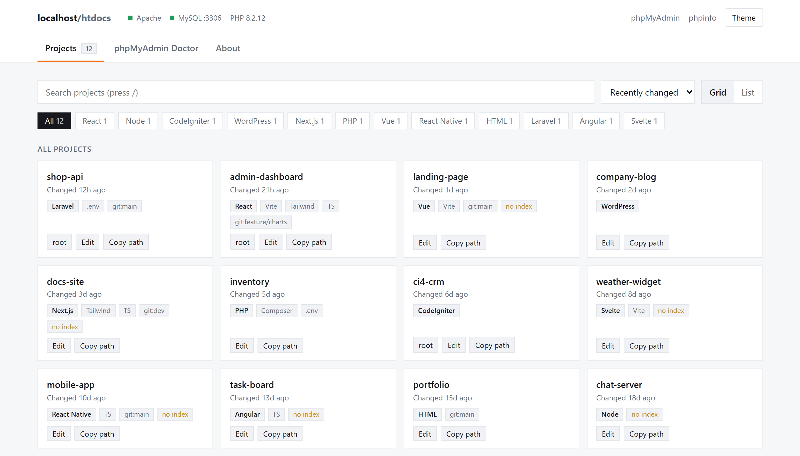

<p align="center">
  
</p>

<p align="center">
  
  
  
  
  
</p>

<p align="center">
  <a href="#features">Features</a> ·
  <a href="#install">Install</a> ·
  <a href="#uninstall">Uninstall</a> ·
  <a href="#keyboard">Keyboard</a> ·
  <a href="#security">Security</a>
</p>

---

A replacement landing page for XAMPP on Windows. It lists every project in `htdocs` and fixes phpMyAdmin when it stops working.

Plain PHP, CSS and JavaScript. No build step, no dependencies, works offline.

<picture>
  <source media="(prefers-color-scheme: dark)" srcset="docs/projects-dark.png">
  
</picture>

## Features

### Projects

- Lists every folder in `htdocs` and detects what it is: PHP, Laravel, CodeIgniter, WordPress, React, React Native, Vue, Angular, Svelte, Next.js, Node, HTML
- Shows git branch, last change, and tags such as Vite, Tailwind, TypeScript and `.env`
- Opens Laravel projects at `/public/` and JS projects at their built `dist/` or `build/` folder
- **Edit** opens a project in your code editor. It lists the editors installed on your PC (VS Code, Cursor, Windsurf, Antigravity, Kiro, Trae, VSCodium, PhpStorm, WebStorm, IntelliJ IDEA, Zed, Sublime Text, Notepad++) and remembers the last one you used
- Search (`/`), filter by type, sort, grid or list view, pin favourites, copy folder path
- Lists `.zip` / `.rar` / `.7z` archives sitting in `htdocs`

### phpMyAdmin Doctor


- Checks: mysqli extension, `config.inc.php`, whether MySQL is running (and what is using the port if it isn't), port mismatch, login (`#1045 Access denied`), control user, `blowfish_secret`, tmp folder, and what `/phpmyadmin/` actually returns
- Reads `mysql_error.log` to explain why MySQL failed to start
- One-click fixes: start MySQL, set credentials (tested before saving), switch between auto login and login screen, fix port, generate cookie secret, disable control user, reset config, repair MySQL from `mysql\backup` ("MySQL shutdown unexpectedly")
- Every config change is backed up as `config.inc.php.xl-<date>` and can be restored from the page
- Every change asks for confirmation in a warning dialog first

> [!CAUTION]
> **Repair MySQL from backup** is a last resort for "MySQL shutdown unexpectedly". Before you press it, copy your whole `xampp\mysql\data` folder somewhere safe. The repair moves your current data to `mysql\data_old_<date>` (and puts it back if a step fails), but InnoDB tables can still come back empty or broken. Keep `data_old_<date>` until you have checked every database in phpMyAdmin.

## Install

> [!NOTE]
> These steps use `C:\xampp`. If XAMPP is somewhere else, like `D:\xampp` or a USB drive, use that folder instead. Nothing in xampp-land depends on where XAMPP is installed.

**1. Download it**

[**Download the ZIP**](https://github.com/aian21/xampp-land/archive/refs/heads/main.zip), then extract it into `C:\xampp\htdocs`. You should end up with a folder like `C:\xampp\htdocs\xampp-land-main` with `install.bat` inside. The folder can have any name.

<details>
<summary>Or clone it with git</summary>

```
cd C:\xampp\htdocs
git clone https://github.com/aian21/xampp-land.git
```

</details>

**2. Double-click `install.bat`**

It backs up `htdocs\index.php` as `index.php.xampp-original`, points `http://localhost/` at xampp-land, and opens it in your browser.

**3. Start Apache** in the XAMPP Control Panel if it isn't running, then go to http://localhost/

<details>
<summary>Do step 2 by hand instead</summary>

`http://localhost/` runs `C:\xampp\htdocs\index.php`, which sends you to the XAMPP dashboard. To point it at xampp-land:

1. Open `C:\xampp\htdocs` in File Explorer.
2. Make a copy of `index.php` and rename the copy to `index.php.xampp-original`. This is your backup.
3. Right-click `index.php` and choose **Open with > Notepad** (or open it in your code editor).
4. Delete everything in the file and paste this in, with your folder's name in place of `xampp-land`:

   ```php
   <?php
   header('Location: /xampp-land/');
   exit;
   ```

5. Save the file.

</details>

## Keyboard

| Key | Action |
| --- | --- |
| <kbd>/</kbd> | Search projects |
| <kbd>Enter</kbd> | Open the first result |
| <kbd>Esc</kbd> | Clear the search |

## Requirements

- XAMPP for Windows (tested with PHP 8.2, MariaDB 10.4, phpMyAdmin 5.2)
- PHP `mysqli` extension (enabled by default in XAMPP)
- For the editor buttons: start Apache from the XAMPP Control Panel. If Apache runs as a Windows service, editors open in a hidden session and you won't see them.

## Security

The Doctor and the editor buttons change things on your PC, so they only respond to requests from `localhost`. Fix requests also need a session CSRF token. The project list is visible to anyone who can reach your Apache server, just as `htdocs` already is.

> [!WARNING]
> Don't expose XAMPP to the internet.

## Uninstall

Double-click `uninstall.bat`. It puts your original `htdocs\index.php` back, so `http://localhost/` opens the XAMPP dashboard again. Then you can delete the folder.

By hand: delete `htdocs\index.php` and rename `index.php.xampp-original` back to `index.php`.

## License

[MIT](LICENSE). Use it, change it, share it.

## Credits

Created by Aian.
